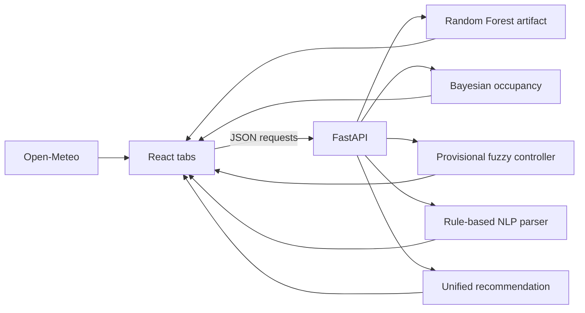

# Mini Project Review II Report

## 1. Title Page

**Project:** HEMS — Cognitive Smart Home Energy Management System  
**Review I title:** Smart Home Appliance Energy Management System: A Data-Driven Hybrid AI Approach for Climate & Load Control  
**Team:** Simran Sayyed, Samee Shaikh, Daksh Shinde, Kanishka Shinde, Muzammil Shivanagi  
**Class/Division:** IT-B  
**Roll numbers:** 48, 53, 62, 63, 64  
**Guide:** [TODO: guide name]  
**College:** [TODO: college name]  
**Department:** Information Technology  
**Subject:** Data Science Lab  
**Academic year:** 2026–27  
**Review:** Mini Project Review II  
**Date:** [TODO: submission date]

## 2. Abstract

HEMS is the Review II implementation of the hybrid-AI direction proposed in Review I. It is a decision-support prototype with a FastAPI backend and React frontend. It combines a Random Forest AC-mode recommender, a Bayesian occupancy estimator, a provisional fuzzy controller, a rule-based natural-language parser, and a simple temperature threshold recommender. The checked-in dataset contains 720 hourly rows, six model features plus timestamp, target, and day-of-month fields, and three classes: 455 Eco, 135 Max Cool, and 130 Dry [random_forest_evaluation.txt]. The in-memory Random Forest reproduced the loaded model hyperparameters and achieved 0.9986111111111111 mean stratified 5-fold accuracy and 0.9974842767295599 mean macro-F1 [random_forest_evaluation.txt]. A time-ordered split containing 576 training rows and 144 test rows achieved 1.0 accuracy and 1.0 macro-F1 [random_forest_evaluation.txt]. All 34 automated tests passed [pytest_full.txt], and all 8 live endpoint checks passed [api_evidence.txt]. Across 42 temperature/humidity scenarios, Random Forest–fuzzy agreement was 0.6190476190476191, Random Forest–threshold agreement was 0.4523809523809524, and fuzzy–threshold agreement was 0.47619047619047616 [api_evidence.txt]. These results demonstrate integration and recovery of synthetic label structure, not real-world accuracy or measured energy savings. The prototype recommends actions only; it does not control appliances.

## 3. Problem Statement and Objectives

Review I framed the problem around tropical and high-humidity homes, where independent cooling appliances can over-cool rooms, ignore occupancy uncertainty, and respond poorly to combined temperature, humidity, and power conditions. Review II narrows that research proposal to a verifiable software prototype: understandable AC advice that considers weather, occupancy, time, humidity, and grid context, without claiming automatic control or savings.

Objectives:

1. Study multi-modal micro-climate data and hybrid AI techniques for home energy advice, continuing the first Review I objective.
2. Implement the Review I cognitive NLP, Bayesian occupancy, and fuzzy-control concepts as distinguishable backend components.
3. Evaluate the Random Forest with accuracy, macro-F1, classification report, confusion matrix, and baselines.
4. Compare learned, fuzzy, and threshold-based recommendations and present disagreement transparently in a React dashboard.
5. Validate request ranges, invalid inputs, and endpoint behavior while documenting the boundary between a recommendation prototype and appliance control.

## 4. Introduction and Literature Survey

Review I proposed a three-stage hybrid architecture: a cognitive NLP engine for human comfort commands, a Bayesian belief network for occupancy uncertainty, and a fuzzy logic engine for continuous climate and load reasoning. It also described a broader multi-appliance goal involving ACs, BLDC fans, and refrigerators, with an interactive Streamlit simulation as the intended presentation layer.

Review II reports the implemented branch rather than the full proposal. The branch replaces the proposed Streamlit presentation with a FastAPI service and React dashboard, and the verified implementation is AC-focused. It exposes multiple distinguishable recommendation components rather than treating them as equivalent. Occupancy probabilities are illustrative, fuzzy rules are provisional, the NLP parser is rule-based, and no appliance actuation is performed. Multi-appliance throttling, inverter-trip prevention, and measured energy optimization remain future scope rather than achieved outcomes.

Review I's literature survey positioned the project against standalone appliance scheduling, rigid temperature thresholds, and hardware-heavy IoT systems, and motivated combining NLP, Bayesian reasoning, and fuzzy logic. The full Review I source list should be carried forward by the student: [TODO: insert the approved Review 1 literature survey references].

## 5. Proposed System and Architecture

The React client obtains optional Mumbai weather from Open-Meteo, sends room inputs to FastAPI, and renders the Random Forest, Bayesian occupancy, fuzzy, and temperature-rule outputs. The backend validates payloads with Pydantic. `/predict/ac` loads the checked-in joblib artifact; `/occupancy/estimate` applies the Bayesian calculation; `/control/fuzzy` imports the Phase 3C controller; `/commands/parse` invokes the rule parser; and `/recommendation` combines distinguishable component outputs. Compared with the Review I proposal, this flow is a recommendation loop: it does not send commands to ACs, fans, refrigerators, inverters, or other appliances.



## 6. Dataset Description and Preprocessing

Review I specified a 30-day, 720-hour synthetic micro-climate dataset. The checked-in Review II dataset has shape `(720, 9)` and columns `timestamp`, `ambient_temp`, `relative_humidity`, `motion_sensor`, `grid_power`, `optimal_ac_mode`, `hour`, `day_of_week`, and `day_of_month` [random_forest_evaluation.txt]. There are zero missing values in every column [random_forest_evaluation.txt]. Numeric minimum, maximum, and mean values are:

| Column | Min | Max | Mean |
|---|---:|---:|---:|
| ambient_temp | 17.45 | 38.86 | 27.987653 |
| relative_humidity | 40.00 | 93.28 | 65.266194 |
| motion_sensor | 0.00 | 1.00 | 0.615278 |
| grid_power | 0.00 | 1.00 | 0.812500 |
| optimal_ac_mode | 0.00 | 2.00 | 0.548611 |
| hour | 0.00 | 23.00 | 11.500000 |
| day_of_week | 0.00 | 6.00 | 3.100000 |
| day_of_month | 1.00 | 30.00 | 15.500000 |

All values in this table are from [random_forest_evaluation.txt]. Class counts are 0/Eco = 455, 1/Max Cool = 135, and 2/Dry = 130 [random_forest_evaluation.txt]. The saved figures are [class distribution](figures/class_distribution.png) and [temperature/humidity scatter](figures/temperature_humidity_by_class.png).

For model evaluation, the six features expected by the artifact were used: `ambient_temp`, `relative_humidity`, `motion_sensor`, `grid_power`, `hour`, and `day_of_week`. The timestamp was parsed only for the time-ordered split; it was not used as a feature. The Random Forest and Decision Tree used numeric values directly. Logistic Regression used `StandardScaler`. No synthetic rows were added and no model artifact was saved by the evaluation script. Review I proposed broader comparisons including Naive Bayes and KNN; those models are not present in the verified Review II evaluation and are therefore not reported as measured results.

Limitations: the dataset is synthetic, the target labels appear rule-generated, and the class imbalance means majority accuracy is not a sufficient quality claim. The artifact was trained under scikit-learn 1.6.1 but evaluated in the current environment with scikit-learn 1.9.1, which emitted an incompatibility warning [random_forest_evaluation.txt].

## 7. Methodology and Algorithms

### Random Forest

The loaded artifact is a `RandomForestClassifier` with `n_estimators=300`, `class_weight=balanced`, `min_samples_leaf=2`, `max_features=sqrt`, `random_state=42`, and the other parameters printed in [random_forest_evaluation.txt]. Its feature importances were ambient temperature 0.307101, relative humidity 0.277173, motion sensor 0.002246, grid power 0.099586, hour 0.306634, and day of week 0.007260 [random_forest_evaluation.txt]. The [feature-importance figure](figures/feature_importances.png) and [holdout confusion matrix](figures/holdout_confusion_matrix.png) are included.

Five-fold stratified cross-validation produced accuracy `0.9986111111111111 ± 0.002777777777777768` and macro-F1 `0.9974842767295599 ± 0.005031446540880502` [random_forest_evaluation.txt]. The majority baseline produced accuracy `0.6319444444444444 ± 0.0` and macro-F1 `0.2581560283687943 ± 0.0`; Logistic Regression with StandardScaler produced accuracy `0.9902777777777778 ± 0.005555555555555536` and macro-F1 `0.9875936340243758 ± 0.007408868976520586` [random_forest_evaluation.txt]. A depth-3 tree fitted on all rows achieved training accuracy `0.9722222222222222` [random_forest_evaluation.txt]. Its compact thresholds, together with the unusually high scores, support the statement that the labels look rule-generated. This does not establish external validity.

**High scores on synthetic labels show the model recovers the generating rules, not real-world accuracy.**

### Bayesian occupancy

For prior \(P(O)\), motion evidence \(M\), and configuration values \(P(M|O)=0.9\), \(P(M|\neg O)=0.05\), the estimator uses:

\[
P(O|M)=\frac{P(M|O)P(O)}{P(M|O)P(O)+P(M|\neg O)(1-P(O))}
\]

For no motion, the complementary likelihoods are used. The time-period priors are morning `0.5`, afternoon `0.45`, evening `0.7`, and night `0.6` [initial_facts.txt]. The complete 4-by-2 table is [occupancy_table.csv]. These probabilities are illustrative assumptions, not ground-truth measurements.

### Fuzzy controller

The controller implements the Review I fuzzy-logic direction for an AC recommendation. It defines temperature sets low, moderate, high, and very-high; humidity sets low, normal, and high; occupancy sets low, medium, and high; and demand sets off, low, medium, high, and maximum. It contains 12 rules, listed in [component_evidence.txt]. Required inputs and outputs are in [fuzzy_table.csv]. Review I described broader multi-appliance load throttling and inverter-overload prevention; this branch does not implement those functions. The membership functions and rules are provisional engineering choices and have not produced measured energy savings.

### NLP parser

The parser uses appliance aliases, AC mode phrases, power phrases, energy-saving phrases, and ambiguity detection. It is rule-based, not a trained language model. Ten live commands were checked against predeclared expected intents; all ten passed [api_evidence.txt]. Unknown and conflicting commands request clarification.

### Threshold rule

The simple reference rule is temperature-only: below 25 °C = Off, 25–less-than-32 °C = Eco, 32–less-than-38 °C = Dry, and at least 38 °C = Max Cool [api_evidence.txt]. It is a comparison baseline, not a measured control policy.

## 8. System Implementation

### Technology stack

Python is 3.12.3, Node is v24.12.0, scikit-learn is 1.9.1, FastAPI is 0.161.1, and scikit-fuzzy is 0.5.0 [repo_facts.txt]. The frontend uses React, Vite, TypeScript, and Recharts as declared in [package.json](../frontend/package.json). The production build completed successfully; Vite reported a chunk-size warning [frontend_build.txt].

### Endpoint table

| Endpoint | Purpose | Validation/output |
|---|---|---|
| GET `/health` | Service status | JSON health response |
| POST `/predict/ac` | Random Forest AC mode | Six validated features; Eco/Max Cool/Dry |
| POST `/occupancy/estimate` | Bayesian occupancy | Timestamp text and boolean motion |
| POST `/commands/parse` | Rule-based NLP | Intent, appliance, value, confidence, clarification |
| POST `/control/fuzzy` | Fuzzy demand and mode | Temperature, humidity, occupancy ranges |
| POST `/recommendation` | Distinguishable combined outputs | AC, occupancy, and fuzzy results |

### Frontend tabs and calls

Review I described an interactive Streamlit dashboard. The implemented Review II branch instead contains exactly four React tabs: Advisor, Planner, Energy, and ML Lab [frontend_surface.txt].

| Tab | Exact backend endpoints / external service |
|---|---|
| Advisor | GET `/health` for status; POST `/predict/ac`, `/occupancy/estimate`, and `/control/fuzzy` through `evaluate`; Open-Meteo current weather |
| Planner | Open-Meteo hourly forecast; repeated POST `/predict/ac`, `/occupancy/estimate`, and `/control/fuzzy` through `evaluate` |
| Energy | No direct backend endpoint; uses the local plan and user-entered assumptions |
| ML Lab | POST `/predict/ac`, `/occupancy/estimate`, and `/control/fuzzy` through `evaluate`; displays client-side charts and threshold rule |

The exact endpoint and Open-Meteo references are saved in [frontend_surface.txt]. The frontend explicitly says the prototype gives advice only and does not control appliances [App.tsx](../frontend/src/App.tsx).

### Validation and run instructions

Pydantic range validation returns 422 for invalid request values. To run the backend:

```bash
git clone https://github.com/Dakshinde/dsl-mini-project.git
cd dsl-mini-project
python3 -m venv .venv
.venv/bin/pip install -r HEMS/requirements.txt
.venv/bin/python -m uvicorn HEMS.main:app --host 127.0.0.1 --port 8000
```

In another terminal:

```bash
cd frontend
npm install
npm run dev
```

## 9. Results, Output Screenshots and Performance Evaluation

### Random Forest results

The time-ordered split used 576 training rows and 144 test rows, producing accuracy `1.0`, macro-F1 `1.0`, and confusion matrix `[[93, 0, 0], [0, 28, 0], [0, 0, 23]]` [random_forest_evaluation.txt]. The full classification report is preserved in that evidence file. These are synthetic-label results.

### Component outputs

The eight required fuzzy inputs and outputs are:

| Temperature | Humidity | Occupancy | Cooling demand | Suggested mode |
|---:|---:|---:|---:|---|
| 25 | 50 | 5 | 5.42 | Off |
| 26 | 50 | 90 | 45.00 | Eco |
| 30 | 50 | 90 | 52.10 | Eco |
| 32 | 70 | 90 | 72.56 | Dry |
| 42 | 60 | 95 | 90.71 | Max Cool |
| 34 | 64 | 80 | 73.28 | Max Cool |
| 34 | 65 | 80 | 74.27 | Dry |
| 38 | 40 | 90 | 78.19 | Max Cool |

This table is also saved as [fuzzy_table.csv] and printed in [component_evidence.txt]. The occupancy combinations are:

| Period | Motion | Prior | Posterior | Percentage |
|---|---|---:|---:|---:|
| morning | false | 0.5 | 0.095238 | 9.523810 |
| morning | true | 0.5 | 0.947368 | 94.736842 |
| afternoon | false | 0.45 | 0.079295 | 7.929515 |
| afternoon | true | 0.45 | 0.936416 | 93.641618 |
| evening | false | 0.7 | 0.197183 | 19.718310 |
| evening | true | 0.7 | 0.976744 | 97.674419 |
| night | false | 0.6 | 0.136364 | 13.636364 |
| night | true | 0.6 | 0.964286 | 96.428571 |

The raw occupancy table is [occupancy_table.csv]. The ten-command NLP table is [nlp_table.csv]; every row passed its expected intent check [api_evidence.txt].

### Comparison of three recommenders

The comparison called `/predict/ac`, then `/occupancy/estimate`, then `/control/fuzzy` for 42 scenarios: temperatures 20 through 40, humidity 50 and 80, hour 12, motion 1, and grid power 1 [api_evidence.txt]. Agreement rates were:

| Pair | Agreement rate |
|---|---:|
| Random Forest vs fuzzy | 0.6190476190476191 |
| Random Forest vs temperature rule | 0.4523809523809524 |
| Fuzzy vs temperature rule | 0.47619047619047616 |
| All three simultaneously | 0.30952380952380953 |

The pairwise rates and 42-row comparison are from [api_evidence.txt]; the all-three rate is from [three_way_agreement.txt]. They differ because the Random Forest uses six features and learned synthetic associations; the fuzzy controller uses temperature, humidity, and occupancy membership/rules; and the threshold rule uses temperature only. The measured feature importances show ambient temperature 0.307101, hour 0.306634, relative humidity 0.277173, grid power 0.099586, day of week 0.007260, and motion 0.002246 [random_forest_evaluation.txt]. Therefore, humidity and occupancy can change fuzzy output without changing the threshold rule, while hour/grid power can change Random Forest output without changing either of the other two. No claim of energy benefit follows.

### Screenshots to add

[SCREENSHOT 1: Swagger /docs]  
[SCREENSHOT 2: Advisor tab]  
[SCREENSHOT 3: “methods disagree” banner]  
[SCREENSHOT 4: ML Lab]  
[SCREENSHOT 5: Planner]  
[SCREENSHOT 6: Energy tab]  
[SCREENSHOT 7: pytest output]  
[SCREENSHOT 8: “Backend not reachable” state]

### Interpretation

The scores show that the implementation can reproduce this synthetic dataset and that the endpoints integrate successfully. They do not show real-world AC-mode accuracy, comfort, generalization to sensor noise, calibrated occupancy, appliance control reliability, or energy savings. Occupancy probabilities are illustrative, fuzzy rules are provisional, and energy savings were never measured. The Energy tab displays estimates based on user assumptions, not an experiment.

## 10. Testing and Validation

The full pytest run collected and passed 34 tests in 2.92 seconds, with 32 warnings [pytest_full.txt]. Warnings include the scikit-learn artifact version mismatch and scikit-fuzzy deprecation messages [pytest_full.txt].

| ID | Endpoint | Input | Expected | Actual | Pass/Fail |
|---|---|---|---:|---:|---|
| T1 | GET `/health` | none | 200 | 200 | Pass |
| T2 | POST `/predict/ac` | valid six-feature payload | 200 | 200 | Pass |
| T3 | POST `/occupancy/estimate` | morning, motion true | 200 | 200 | Pass |
| T4 | POST `/commands/parse` | turn on the AC | 200 | 200 | Pass |
| T5 | POST `/control/fuzzy` | 32, 70, 90 | 200 | 200 | Pass |
| T6 | POST `/recommendation` | 27, 70, 90 | 200 | 200 | Pass |
| T7 | POST `/predict/ac` | temperature 46 | 422 | 422 | Pass |
| T8 | POST `/control/fuzzy` | humidity 101 | 422 | 422 | Pass |

The raw table and responses are [curl_test_table.csv] and [curl_raw.json]. The two invalid cases returned 422 as required [api_evidence.txt].

## 11. Individual Contributions

| Member | Contribution |
|---|---|
| Simran Sayyed | [TODO: contribution] |
| Samee Shaikh | [TODO: contribution] |
| Daksh Shinde | [TODO: contribution] |
| Kanishka Shinde | [TODO: contribution] |
| Muzammil Shivanagi | [TODO: contribution] |

Git authorship is not proof of individual contribution; contributions must be confirmed by the team.

## 12. Conclusion and Future Scope

The Review II objectives were met at prototype level: the project exposes the requested backend components, documents the synthetic dataset and preprocessing, evaluates the trained artifact and baselines, compares three recommenders, validates endpoints, and provides a working React build. This is a concrete refinement of Review I's hybrid-AI proposal, not evidence that the full multi-appliance control vision has been completed. The measured evidence supports integration and synthetic-label recovery, but not claims of field performance. The system recommends only and does not control appliances; energy savings were never measured. Inverter-trip prevention, real appliance scheduling, and real occupancy validation remain unimplemented.

Future work:

- collect real sensor data with ESP32 devices;
- create a reproducible training pipeline rather than relying on a checked-in artifact;
- retrain using user feedback;
- run measured energy tests;
- obtain real occupancy ground truth;
- add safe, separately validated hardware control;
- add a voice assistant.

## 13. References and Appendix

1. L. Breiman, “Random Forests,” *Machine Learning*, 45(1), 2001.
2. L. A. Zadeh, “Fuzzy sets,” *Information and Control*, 8(3), 1965.
3. F. Pedregosa et al., “Scikit-learn: Machine Learning in Python,” *Journal of Machine Learning Research*, 12, 2011.
4. [FastAPI documentation](https://fastapi.tiangolo.com/)
5. [scikit-fuzzy documentation](https://scikit-fuzzy.github.io/scikit-fuzzy/)
6. [React documentation](https://react.dev/)
7. [Vite documentation](https://vite.dev/guide/)
8. [Recharts documentation](https://recharts.org/en-US/)
9. [Open-Meteo documentation](https://open-meteo.com/en/docs)
10. [TODO: Review 1 references]

### Source files and line counts

The line counts below were produced by the repository command saved in [repo_facts.txt]. They are source-file counts, not measures of contribution.

| Source file | Lines |
|---|---:|
| `tests/test_api.py` | 288 |
| `Output 3C/fuzzy_controller.py` | 153 |
| `HEMS/__init__.py` | 0 |
| `HEMS/schemas.py` | 293 |
| `HEMS/main.py` | 650 |
| `output phase 3b/nlp_parser.py` | 162 |
| `frontend/src/types.ts` | 37 |
| `frontend/src/api.ts` | 176 |
| `frontend/src/vite-env.d.ts` | 1 |
| `frontend/src/main.tsx` | 10 |
| `frontend/src/App.tsx` | 984 |

No Random Forest training script is present [repo_facts.txt]. Repository URL: `https://github.com/Dakshinde/dsl-mini-project.git` [repo_facts.txt].

### Evidence index

All raw command outputs are in [evidence/](evidence/). The report-generation scripts are [evaluate_rf.py](evaluate_rf.py), [component_evidence.py](component_evidence.py), and [api_evidence.py](api_evidence.py).

### Review II checklist

| Mandatory item | Section | Status |
|---|---|---|
| Working prototype | 5, 8 | Done |
| Dataset and preprocessing | 6 | Done |
| Trained model | 7, 9 | Done |
| 5 test cases | 10 | Done |
| Metrics | 7, 9 | Done |
| Screenshots | 9 | Needs screenshots |
| Comparison | 9 | Done |
| Contributions | 11 | Needs student input |
| Source code and run steps | 8, 13 | Done |
